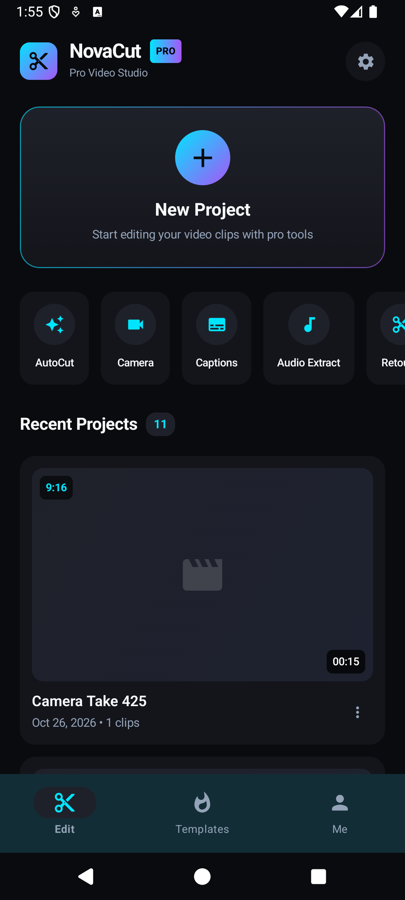
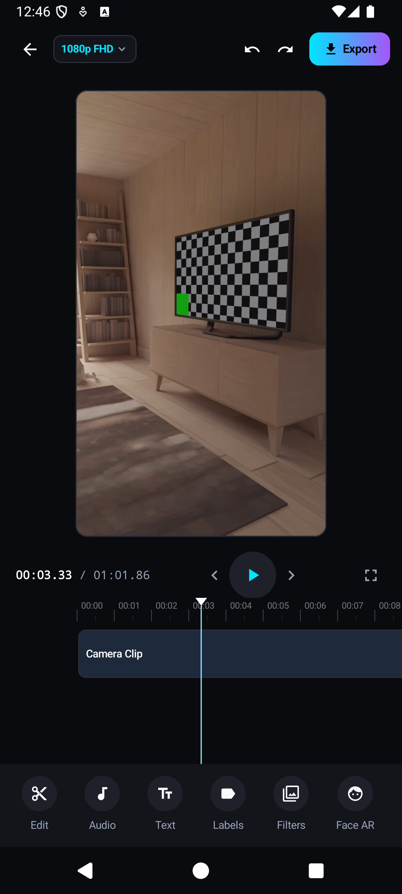
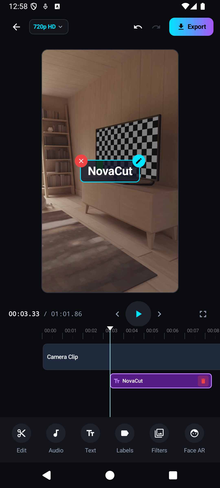
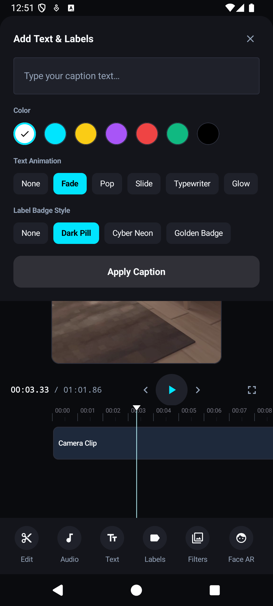
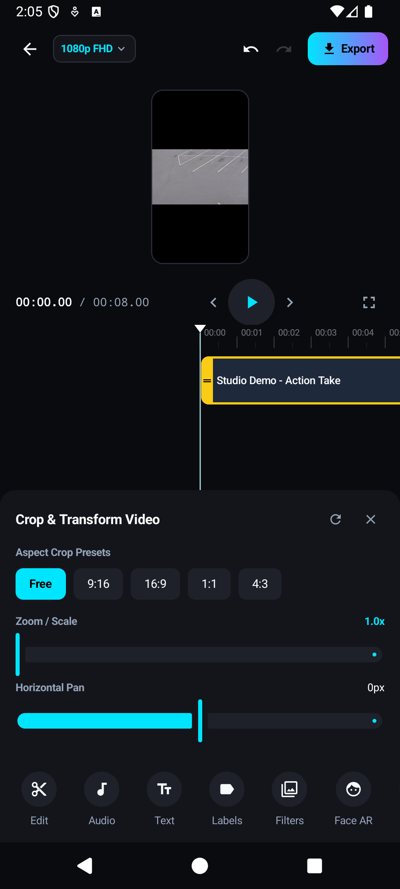
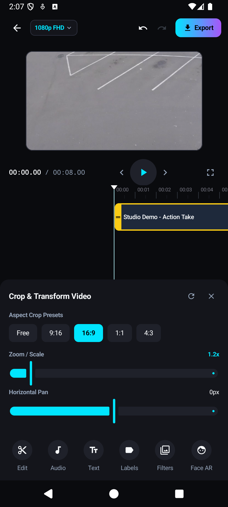
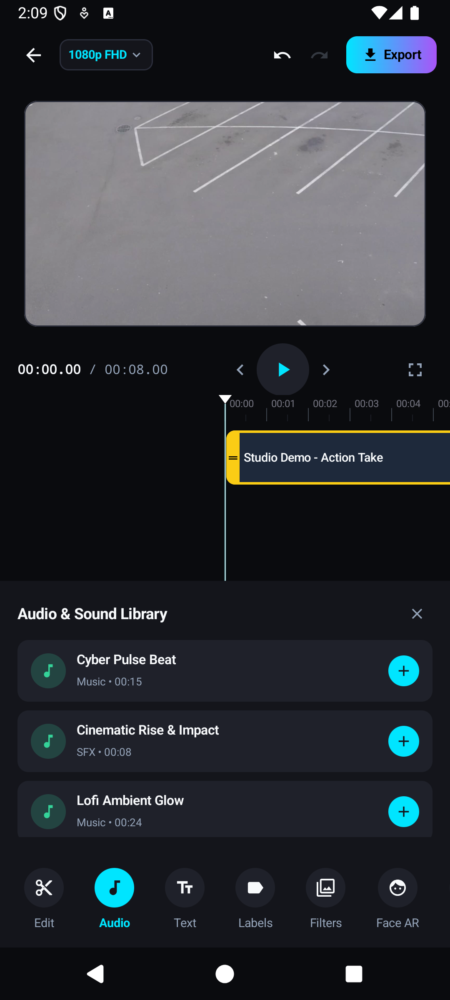
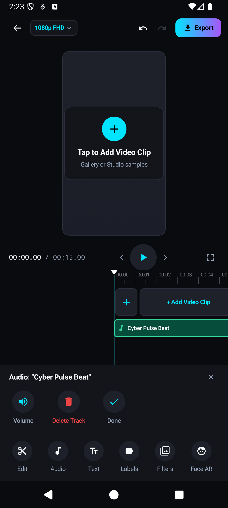

# NovaCut — Professional Mobile Video Editor Studio for Android

[](https://developer.android.com/)
[](https://kotlinlang.org/)
[](https://developer.android.com/jetpack/compose)
[](https://developer.android.com/media/media3)
[]()

**NovaCut** is a production-grade, white-labeled mobile video editing application built from the ground up for Android using **Jetpack Compose**, **AndroidX Media3 (ExoPlayer & Transformer)**, and **CameraX**. Engineered with high-performance real-time multi-track rendering, professional viral overlay tools, hardware-accelerated video export, and offline/online cloud template synchronization.

---

## 📱 App Screenshots & Visual Showcase

| 1. Studio Dashboard | 2. Camera-Recorded Playback |
| :---: | :---: |
|  |  |
| *Recent project cards with aspect badges, Pro Banner, AutoCut, Camera & Audio tools.* | *Real CameraX recorded hardware video playing directly in editor with playhead & controls.* |

| 3. Interactive Text Overlays | 4. Rich Caption & Animation Sheet |
| :---: | :---: |
|  |  |
| *Direct canvas dragging, corner Edit & Delete handles, timeline text track with trash delete.* | *Color palettes, text animations (Fade, Pop, Slide, Typewriter, Glow), and label badges.* |

| 5. Video Crop & Transform Studio | 6. Dynamic 16:9 Aspect Cropping |
| :---: | :---: |
|  |  |
| *Aspect crop presets (Free, 9:16, 16:9, 1:1, 4:3), zoom scale (1.0x - 3.0x), and pan sliders.* | *Real-time video viewport reshaping and hardware scaling to 16:9 widescreen format.* |

| 7. Built-in Audio & Sound Library | 8. Multi-Track Audio Editing |
| :---: | :---: |
|  |  |
| *Categorized royalty-free beats, cinematic impacts, and lofi ambient tracks.* | *Timeline drag-to-move start time, dedicated audio sub-toolbar, volume & delete options.* |

---

## 🚀 Key Features

### 1. CameraX Hardware Recording & Direct Cache Preservation
- **Real Hardware Capture**: Integrated `VideoCapture<Recorder>` with `FileOutputOptions` saving MP4 files directly to app cache.
- **Immediate Playback**: Recorded camera takes open directly in the editor and playback real recorded frames without dummy video fallbacks.
- **Device Gallery Integration**: In-app picker with support for external device videos and bundled offline studio demo samples.

### 2. Multi-Track Timeline Engine
- **Time-Synchronized Ruler**: High-precision ruler with second and millisecond markers, zoom level adjustments (0.5x to 5.0x).
- **Filmstrip Video Track**: Real-time thumbnail previews, split at playhead, speed adjustments (0.1x to 10.0x), in-animations, and clip rotation.
- **Interactive Text Track**: Purple timeline strips with text preview, drag-to-move start time, inline deletion, and selection sync.
- **Audio Sound Track**: Green audio track with waveform indicator, horizontal drag positioning, and dedicated track management.

### 3. Video Crop & Transform Controls
- **Aspect Ratio Presets**: One-tap switching between **Free**, **9:16** (TikTok, Reels, Shorts), **16:9** (YouTube widescreen), **1:1** (Instagram square), and **4:3**.
- **Zoom & Scale**: Smooth slider zooming from `1.0x` up to `3.0x` with live numeric readouts.
- **2D Pan Offsets**: Horizontal and Vertical pan sliders (`-300px` to `+300px`) for framing clips within the canvas.
- **Live Canvas Adjustment**: Viewport aspect ratio automatically adapts to match the active crop preset.

### 4. Interactive Canvas Text & Overlay System
- **Touch Dragging**: Move text anywhere across the video preview canvas with silky-smooth gesture tracking.
- **Corner Action Handles**:
  - **Red Close Handle (Top-Start)**: One-tap instant deletion of the selected text overlay.
  - **Cyan Pencil Handle (Top-End)**: Opens the text editor sheet with all parameters pre-populated.
- **Docked Text Sub-Toolbar**:
  - **Edit Text**: Modify caption string, typography, and styling.
  - **Style & Badges**: Dark Pill, Cyber Neon, and Golden Badge styles with custom ARGB colors.
  - **Animations**: Fade, Pop, Slide, Typewriter, and Glow animations.
  - **Duplicate**: Clones the text overlay with a smart position offset.
  - **Delete**: Cleanses the overlay from canvas and timeline.

### 5. Multi-Track Audio Management
- **Sound Library**: Built-in library of beats, cinematic sound effects, and ambient background music.
- **Timeline Moving**: Touch and drag audio clips horizontally to align them with specific video scenes.
- **Audio Sub-Toolbar**: Select any audio track on the timeline to adjust track volume, mute, or delete unwanted tracks.

### 6. Video Export Engine
- **Hardware Transformer**: Hardware-accelerated MP4 rendering via AndroidX Media3 Transformer.
- **Multi-Resolution**: Export in **720p HD**, **1080p FHD**, or **4K UHD** with adjustable frame rates (24, 30, 60 fps).
- **Real-Time Progress**: Export progress tracking with percentage completion, speed, and time estimation.

---

## 🛠️ Architecture & Tech Stack

```
com.novacut.editor
├── core/
│   ├── di/               # Lightweight ServiceLocator dependency injection
│   └── util/             # FileUtils, SampleVideoProvider, TimeFormatter
├── data/
│   ├── engine/           # PlaybackEngine (ExoPlayer), ExportEngine (Media3 Transformer)
│   └── repository/       # LocalProjectRepository (SharedPreferences + kotlinx.serialization)
├── domain/
│   ├── model/            # Project, VideoClip, AudioClip, TextOverlay, Resolution, AspectRatio
│   ├── repository/       # Repository interfaces
│   └── usecase/          # Clean Architecture Use Cases (Split, Trim, Crop, Text, Audio)
└── presentation/
    ├── navigation/       # Type-safe Compose navigation
    ├── theme/            # Studio Dark Theme, typography, color tokens
    ├── ui/               # CameraScreen, ProjectsScreen, EditorScreen, ExportScreen
    │   └── editor/components/
    │       ├── VideoPreviewCanvas.kt     # ExoPlayer view + interactive overlay layer
    │       ├── timeline/                 # MultiTrackTimeline, AudioTrackView, TextTrackView
    │       └── toolbars/                 # CropPanel, TextSubToolbar, AudioSubToolbar, AudioPanel
    └── viewmodel/        # EditorViewModel, ProjectsViewModel, ExportViewModel
```

---

## ⚙️ How to Build & Run

### Prerequisites
- **Android Studio Ladybug** or newer / **JDK 17**
- **Android SDK Platform 35** (minimum SDK: 26)
- **Node.js 18+** (for optional backend template server)

### 1. Build and Install Android App
```bash
# Clone the repository
cd "NovaCut code"

# Build debug APK
./gradlew assembleDebug

# Install on connected device or running emulator
adb install -r app/build/outputs/apk/debug/app-debug.apk

# Launch NovaCut
adb shell am start -n com.novacut.editor/.MainActivity
```